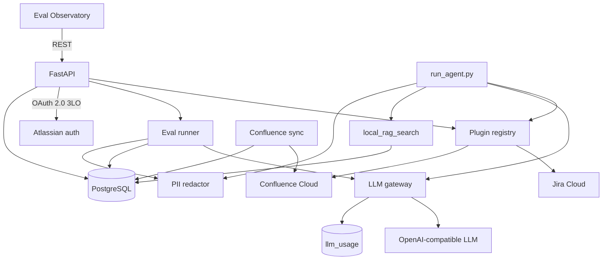

# Atlassian Agent Kit

A Python framework for calling Jira and Confluence as tools, then measuring whether an LLM picks the right tool and arguments. It ships a FastAPI backend, a React eval dashboard, an OAuth client for Atlassian Cloud, a Confluence sync pipeline, a local document search index, a redactor that strips sensitive text before it leaves the process, and a ledger of LLM token use and USD cost.

Python 3.11+. The LLM client talks to an OpenAI-compatible API (configured for Groq by default).

## What it does

- **Tool-calling agent.** `scripts/run_agent.py` loads every plugin, redacts the prompt, and runs a multi-turn loop: the model calls a tool, the registry executes it against Jira or Confluence (or searches the local document index), and the result is redacted again before the next turn.
- **Eval harness.** Cases in `evals/cases.yaml` ask the model to choose a tool and fill parameters. Judges score the result with exact match, subset match, or a second LLM for JQL that is semantically equivalent. Runs land in PostgreSQL (`eval_runs`) with duration and judge reasoning.
- **Description tuning.** `evals/variants.yaml` holds alternate tool descriptions. `make tune` runs the same cases against each variant and records pass rate so you can see which wording the model follows.
- **Eval Observatory.** The React app (`frontend/`) polls the API and shows pass rate over time, variant comparison, recent runs, regressions, the active JSON schemas, and LLM spend for the last 30 days. It can start a suite from the UI.
- **LLM usage.** Every model call goes through `agentkit.llm.chat_completion`. The gateway records input and output tokens, duration, and a USD cost in `llm_usage`. Eval cases are tagged `agent` and `judge`; the CLI agent is tagged `agent_loop`. Tuning reuses the agent path.
- **Atlassian access.** OAuth 2.0 (3LO) stores encrypted access and refresh tokens. Basic auth with an API token is also supported for scripts. Built-in tools cover Jira search, get, create, and transition, plus Confluence list spaces, fetch a page as Markdown, and create a page.
- **Confluence sync.** An async client pulls a space, converts storage format to Markdown, and upserts `page_snapshots` by content hash so unchanged pages are skipped.
- **Local document search.** Markdown and text files are chunked, embedded with Ollama, and stored in Postgres with pgvector. The agent tool `local_rag_search` returns cited excerpts ranked by cosine similarity.
- **PII redaction.** Pattern detectors (email, phone, card, IBAN, keys, and similar) replace matches with keyed placeholders before prompts, tool results, and judge payloads go to the model. The placeholder map stays in process. Optional Presidio is available via the `pii` extra.

Built-in plugins also include local time tools (`get_current_time`, `convert_timezone`) that do not call Atlassian.

## Architecture



Plugins are discovered from three places: `src/agentkit/plugins/builtin/`, `*.py` files in `plugins/` (`PLUGINS_DIR`), and the `agentkit.plugins` entry-point group.

## Quick start

```bash
cp .env.example .env
# Fill POSTGRES_*, DATABASE_URL, TOKEN_ENCRYPTION_KEY, and GROQ_API_KEY.
# Generate a Fernet key with: make keygen

make install
make up          # Postgres 16 with pgvector via docker compose
make migrate
make seed        # jira and confluence integration rows
python scripts/seed_tool_schemas.py   # baseline tool descriptions the evals attach to
make verify
make run         # API on http://localhost:8000
make web         # dashboard on http://localhost:5173
```

The Vite dev server proxies `/api`, `/auth`, and `/health` to port 8000.

For a live agent call you also need Atlassian credentials. OAuth uses `ATLASSIAN_CLIENT_ID` and `ATLASSIAN_CLIENT_SECRET`; open `http://localhost:8000/auth/atlassian/authorize`. Basic auth uses `ATLASSIAN_SITE_URL`, `ATLASSIAN_EMAIL`, and `ATLASSIAN_API_TOKEN`:

```bash
make agent prompt="List Confluence spaces" auth=basic
```

`docker compose up` builds the API (runs migrations, then uvicorn on port 8000) and the frontend (nginx on port 80) alongside Postgres.

## Commands

| Command | What it does |
| --- | --- |
| `make test` | pytest |
| `make lint` | ruff on `src`, `tests`, and `scripts` |
| `make evals` | run `evals/cases.yaml` against the live model and persist results (`c=4` sets concurrency) |
| `make evals-dry-run` | score cases using the expected tool call, no LLM |
| `make tune tool=search_issues trials=3` | compare description variants for one tool |
| `make sync space=EW c=8` | concurrent Confluence space sync with a benchmark report |
| `make rag-ingest dir=docs` | chunk and embed every `.md` and `.txt` file under that directory |
| `make rag-search q="journal entries" k=5` | nearest chunks for a query |
| `make new-plugin name=github` | scaffold `plugins/github.py` |

## Evals

Each case names a prompt, `expected_tool`, `expected_params`, and a `judge_mode`:

- `exact_match`: arguments must equal the expected dict
- `subset_match`: every expected key must be present with the same value
- `semantic_jql`: a judge model decides whether the JQL would return the same issues

`GET /api/overview`, `/api/evals`, `/api/evals/timeseries`, `/api/tools`, and `/api/regressions` feed the dashboard. `POST /api/evals/run` starts a suite in the background. A regression is a case that previously passed for the same prompt and active tool schema and now fails.

## LLM usage

Prices are not hardcoded. The gateway loads Groq's published models table and prompt-caching page (`GROQ_MODELS_DOC_URL`, `GROQ_PROMPT_CACHING_DOC_URL`), caches them for `LLM_PRICING_TTL_SECONDS` (default one hour), and prices each call per million tokens. Cached prompt tokens use the discount Groq publishes for that model.

Token counts come from the provider's usage object. If that object is missing, the gateway estimates tokens and marks the row `estimated`. If a price cannot be resolved (unknown model, or `LLM_BASE_URL` pointing somewhere other than Groq), the call still completes and the row is stored with cost `0`. A failed insert is logged and does not fail the call.

`GET /api/usage/summary?days=30` returns totals, a breakdown by purpose and by model, and a daily series. `GET /api/usage/recent` returns the latest rows. The dashboard charts daily cost and cost by purpose from the summary.

## Local documents

Postgres runs from `pgvector/pgvector:pg16`. Migrations enable the `vector` extension and store chunks in `document_chunks` with a 768-dimension embedding and an HNSW index on cosine distance.

Ingest walks a directory for `.md` and `.txt` files, splits each file on paragraphs, lines, and sentences (`RAG_CHUNK_SIZE` 800, `RAG_CHUNK_OVERLAP` 120), and skips a chunk whose content hash is already stored. `replace_source` on the HTTP ingest route deletes that source first and writes it again.

Embeddings come from Ollama (`OLLAMA_BASE_URL`, default `http://localhost:11434`) using `RAG_EMBED_MODEL` (`nomic-embed-text`). Pull that model before the first ingest. If Ollama is down and `RAG_ALLOW_HASH_FALLBACK` is true, ingest and search fall back to a deterministic hash embedding of the same dimension. Otherwise they fail.

Search embeds the query the same way and returns the top `RAG_TOP_K` chunks (default 5) above an optional score floor. Each hit includes source, page, chunk index, score, and an excerpt. The CLI agent and the eval agent both expose this as the `local_rag_search` tool.

```bash
ollama pull nomic-embed-text
make rag-ingest dir=docs
make rag-search q="journal entries"
```

`POST /api/rag/ingest` accepts `{"documents": [{"source", "content", "page"?}], "replace_source": false}`. `POST /api/rag/search` accepts `{"query", "k"?, "sources"?}`. `GET /api/rag/stats` returns chunk count, source count, and the embed model name.

## PII

Redaction is on by default (`PII_ENABLED=true`). `POST /api/pii/redact` returns the scrubbed text, a count, and the kinds that matched. It does not return the original values. Set `PII_USE_PRESIDIO=true` and install the extra if you want the Presidio engine:

```bash
pip install -e ".[dev,pii]"
```

## Plugins

A plugin subclasses `IntegrationPlugin`, declares `tools()` (name, description, Pydantic input model, handler), and optionally `create_client()`. The contract tests in `tests/test_plugin_contract.py` check schema validity, unique tool names, and dispatch.

```bash
make new-plugin name=github
pytest tests/test_plugin_contract.py
```

Third-party packages can register the same way:

```toml
[project.entry-points."agentkit.plugins"]
github = "my_pkg.plugins:GithubPlugin"
```

`GET /api/plugins` lists loaded plugins, their tools, and any load errors.