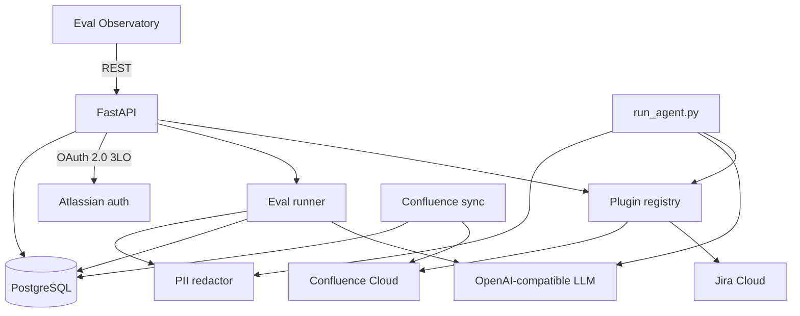

# Atlassian Agent Kit

A Python framework for calling Jira and Confluence as tools, then measuring whether an LLM picks the right tool and arguments. It ships a FastAPI backend, a React eval dashboard, an OAuth client for Atlassian Cloud, a Confluence sync pipeline, and a redactor that strips sensitive text before it leaves the process.

Python 3.11+. The LLM client talks to an OpenAI-compatible API (configured for Groq by default).

## What it does

- **Tool-calling agent.** `scripts/run_agent.py` loads every plugin, redacts the prompt, and runs a multi-turn loop: the model calls a tool, the registry executes it against Jira or Confluence, and the result is redacted again before the next turn.
- **Eval harness.** Cases in `evals/cases.yaml` ask the model to choose a tool and fill parameters. Judges score the result with exact match, subset match, or a second LLM for JQL that is semantically equivalent. Runs land in PostgreSQL (`eval_runs`) with duration and judge reasoning.
- **Description tuning.** `evals/variants.yaml` holds alternate tool descriptions. `make tune` runs the same cases against each variant and records pass rate so you can see which wording the model follows.
- **Eval Observatory.** The React app (`frontend/`) polls the API and shows pass rate over time, variant comparison, recent runs, regressions, and the active JSON schemas. It can start a suite from the UI.
- **Atlassian access.** OAuth 2.0 (3LO) stores encrypted access and refresh tokens. Basic auth with an API token is also supported for scripts. Built-in tools cover Jira search, get, create, and transition, plus Confluence list spaces, fetch a page as Markdown, and create a page.
- **Confluence sync.** An async client pulls a space, converts storage format to Markdown, and upserts `page_snapshots` by content hash so unchanged pages are skipped.
- **PII redaction.** Pattern detectors (email, phone, card, IBAN, keys, and similar) replace matches with keyed placeholders before prompts, tool results, and judge payloads go to the model. The placeholder map stays in process. Optional Presidio is available via the `pii` extra.

Built-in plugins also include local time tools (`get_current_time`, `convert_timezone`) that do not call Atlassian.

## Architecture



Plugins are discovered from three places: `src/agentkit/plugins/builtin/`, `*.py` files in `plugins/` (`PLUGINS_DIR`), and the `agentkit.plugins` entry-point group.

## Quick start

```bash
cp .env.example .env
# Fill POSTGRES_*, DATABASE_URL, TOKEN_ENCRYPTION_KEY, and GROQ_API_KEY.
# Generate a Fernet key with: make keygen

make install
make up          # Postgres 16 via docker compose
make migrate
make seed        # jira and confluence integration rows
python scripts/seed_tool_schemas.py   # baseline tool descriptions the evals attach to
make verify
make run         # API on http://localhost:8000
make web         # dashboard on http://localhost:5173
```

The Vite dev server proxies `/api`, `/auth`, and `/health` to port 8000.

For a live agent call you also need Atlassian credentials. OAuth uses `ATLASSIAN_CLIENT_ID` and `ATLASSIAN_CLIENT_SECRET`; open `http://localhost:8000/auth/atlassian/authorize`. Basic auth uses `ATLASSIAN_SITE_URL`, `ATLASSIAN_EMAIL`, and `ATLASSIAN_API_TOKEN`:

```bash
make agent prompt="List Confluence spaces" auth=basic
```

`docker compose up` builds the API (runs migrations, then uvicorn on port 8000) and the frontend (nginx on port 80) alongside Postgres.

## Commands

| Command | What it does |
| --- | --- |
| `make test` | pytest |
| `make lint` | ruff on `src`, `tests`, and `scripts` |
| `make evals` | run `evals/cases.yaml` against the live model and persist results (`c=4` sets concurrency) |
| `make evals-dry-run` | score cases using the expected tool call, no LLM |
| `make tune tool=search_issues trials=3` | compare description variants for one tool |
| `make sync space=EW c=8` | concurrent Confluence space sync with a benchmark report |
| `make new-plugin name=github` | scaffold `plugins/github.py` |

## Evals

Each case names a prompt, `expected_tool`, `expected_params`, and a `judge_mode`:

- `exact_match`: arguments must equal the expected dict
- `subset_match`: every expected key must be present with the same value
- `semantic_jql`: a judge model decides whether the JQL would return the same issues

`GET /api/overview`, `/api/evals`, `/api/evals/timeseries`, `/api/tools`, and `/api/regressions` feed the dashboard. `POST /api/evals/run` starts a suite in the background. A regression is a case that previously passed for the same prompt and active tool schema and now fails.

## PII

Redaction is on by default (`PII_ENABLED=true`). `POST /api/pii/redact` returns the scrubbed text, a count, and the kinds that matched. It does not return the original values. Set `PII_USE_PRESIDIO=true` and install the extra if you want the Presidio engine:

```bash
pip install -e ".[dev,pii]"
```

## Plugins

A plugin subclasses `IntegrationPlugin`, declares `tools()` (name, description, Pydantic input model, handler), and optionally `create_client()`. The contract tests in `tests/test_plugin_contract.py` check schema validity, unique tool names, and dispatch.

```bash
make new-plugin name=github
pytest tests/test_plugin_contract.py
```

Third-party packages can register the same way:

```toml
[project.entry-points."agentkit.plugins"]
github = "my_pkg.plugins:GithubPlugin"
```

`GET /api/plugins` lists loaded plugins, their tools, and any load errors.